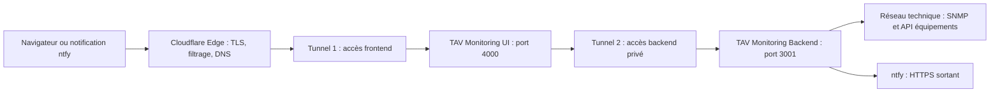

# Sécurité du système TAV Monitoring

## 1. Objet du document

Ce document décrit les mécanismes de sécurité du système TAV Monitoring :

- séparation entre le frontend et le backend de supervision ;
- authentification et gestion des autorisations ;
- accès aux équipements techniques ;
- alertes ntfy et vue synthétique sans connexion ;
- publication par un double tunnel Cloudflare ;
- secrets, journaux, limites connues et recommandations d'exploitation.

Le document décrit l'architecture cible. Les fichiers de configuration `cloudflared`
ne sont pas présents dans ce dépôt : les noms de tunnels, règles DNS et politiques
Cloudflare Access doivent donc être vérifiés sur l'infrastructure de production.

## 2. Périmètre et composants

| Composant | Rôle | Port local par défaut | Exposition attendue |
|---|---|---:|---|
| `TAV_Monitoring_UI` | Interface Web et proxy des API | 4000 | Accessible via Cloudflare |
| `TAV_Monitoring_Backend` | Authentification, monitoring, API et alertes | 3001 | Privé, jamais publié directement |
| Équipements SNMP/API | Sources de télémétrie | Selon le protocole | Réseau technique local uniquement |
| ntfy | Transport des notifications | HTTPS sortant | Aucun accès entrant au SI |
| Cloudflare Tunnel | Publication sans port entrant | Connexion HTTPS sortante | Point d'entrée contrôlé |

Le navigateur ne doit jamais contacter directement les équipements supervisés.
Seul le backend possède les communautés SNMP, mots de passe API et autres secrets
nécessaires à leur interrogation.

## 3. Architecture avec double tunnel Cloudflare

L'architecture recommandée emploie deux tunnels indépendants afin de séparer le
trafic utilisateur du trafic interservice.

### Tunnel 1 — frontend

Le premier tunnel publie uniquement le frontend, par exemple sous
`https://tav.vdoconnect.net`. Cloudflare termine TLS puis transmet la requête au
service local du frontend sur le port 4000.

Ce tunnel peut laisser accessibles sans compte :

- la page de connexion ;
- les ressources statiques nécessaires ;
- `/status`, qui ne contient aucune donnée avant validation d'un jeton signé.

Les pages `/monitoring`, `/configuration` et `/users` restent protégées par
l'authentification applicative. Cloudflare Access peut ajouter un premier contrôle
d'identité devant ces pages, sans remplacer les rôles applicatifs.

### Tunnel 2 — backend

Le second tunnel donne au frontend un accès au backend. Il doit être considéré
comme un canal interservice et ne doit pas constituer une API publique librement
accessible.

Configuration recommandée :

- hostname distinct et non présenté aux utilisateurs, par exemple
  `tav-api.vdoconnect.net` ;
- politique Cloudflare Access de type service-to-service ;
- jeton de service Cloudflare transmis uniquement par le frontend ;
- aucun enregistrement DNS ou règle d'ingress permettant de contourner Access ;
- port 3001 lié à `127.0.0.1` ou filtré par le pare-feu local ;
- aucune redirection générique de type `/*` vers le backend en dehors des routes
  explicitement requises.

Le double tunnel limite les mouvements latéraux : compromettre une page publique
du frontend ne donne pas automatiquement un accès réseau direct aux équipements.
Cette séparation n'est toutefois efficace que si le second tunnel exige une
identité de service et si le port backend n'est pas accessible autrement.

> **Point à vérifier avant production** : le fichier
> `TAV_Monitoring_UI/config.json` référence actuellement
> `https://tav.vdoconnect.net` comme URL backend. Dans une architecture à deux
> tunnels, cette valeur devrait normalement désigner le hostname privé du second
> tunnel. Utiliser le même hostname pour le frontend et le backend nécessite des
> règles Cloudflare par chemin très précises et augmente le risque de boucle de
> proxy ou d'exposition involontaire.

## 4. Authentification applicative

Les utilisateurs sont stockés dans `users.json`. Les mots de passe ne sont jamais
enregistrés en clair : ils sont dérivés avec `scrypt` et un sel aléatoire propre à
chaque compte.

Après connexion, le backend crée un jeton de session aléatoire de 256 bits. La
session est conservée en mémoire côté serveur et référencée par le cookie
`tav_session` :

- `HttpOnly` empêche sa lecture directe par JavaScript ;
- `SameSite=Strict` réduit les risques de requêtes intersites et de CSRF ;
- durée par défaut : 12 heures, prolongée lors d'une activité valide ;
- déconnexion et suppression d'un utilisateur invalident ses sessions connues ;
- un redémarrage du backend invalide toutes les sessions, puisqu'elles ne sont pas
  persistées.

Trois rôles sont appliqués côté backend :

| Rôle | Capacités principales |
|---|---|
| `user` | Consultation du monitoring authentifié |
| `editor` | Consultation et modification de la configuration opérationnelle |
| `administrator` | Gestion complète, utilisateurs et test des alertes |

Le contrôle effectué par l'interface n'est qu'ergonomique : le backend revérifie
le rôle sur chaque opération sensible.

### Renforcement nécessaire du cookie

Le cookie possède `HttpOnly` et `SameSite=Strict`, mais le code actuel n'ajoute pas
l'attribut `Secure`. En production HTTPS, cet attribut doit être ajouté afin que
le navigateur ne transmette jamais la session sur une connexion HTTP. Il est aussi
recommandé d'utiliser le préfixe de cookie `__Host-` lorsque les contraintes de
déploiement le permettent.

## 5. Vue synthétique ouverte depuis ntfy

Les notifications peuvent ouvrir une page de statut sans demander le login et le
mot de passe. Il ne s'agit pas d'un contournement de l'authentification : cette vue
utilise un canal distinct, limité et explicitement filtré.

### Fonctionnement

1. Lors de l'envoi d'une notification, le backend génère un jeton contenant une
   version, une expiration et une valeur aléatoire.
2. Le jeton est signé en HMAC-SHA-256 avec `TAV_PUBLIC_STATUS_SECRET`.
3. ntfy reçoit une URL de la forme `https://tav.vdoconnect.net/status#jeton`.
4. La partie située après `#` n'est envoyée ni à Cloudflare ni au serveur Web lors
   du chargement initial, ce qui évite sa présence dans les journaux d'accès.
5. Le JavaScript de la page retire immédiatement le fragment de l'historique puis
   transmet le jeton par `POST /api/public/status`.
6. Le backend vérifie la signature et l'expiration avant de produire un résumé.

La réponse publique contient uniquement :

- le nom fonctionnel de l'équipement ;
- son état synthétique ;
- le nombre d'anomalies et l'élément fonctionnel concerné ;
- l'état attendu dans la référence et l'état actuel, sans valeur technique brute ;
- l'heure du dernier résultat et de la génération de la vue.

Elle exclut les adresses IP, communautés SNMP, mots de passe, clés API,
configurations, identifiants utilisateur et télémétries détaillées.

### Propriétés et limites du jeton

- le secret doit contenir au moins 32 caractères aléatoires ;
- la durée par défaut est de 86 400 secondes, soit 24 heures ;
- modifier `TAV_PUBLIC_STATUS_SECRET` invalide immédiatement tous les liens ;
- un jeton modifié, mal signé ou expiré reçoit une réponse HTTP 401 ;
- les réponses portent `Cache-Control: no-store` ;
- la page interdit l'indexation, l'intégration en iframe et les sources de contenu
  externes grâce à ses en-têtes de sécurité.

Le jeton est un **bearer token** : toute personne qui possède la notification peut
ouvrir la vue jusqu'à son expiration. Il faut donc masquer le contenu des
notifications sur les écrans verrouillés lorsque le contexte l'exige. Les jetons
ne sont actuellement ni à usage unique ni révocables individuellement.

## 6. Sécurité de ntfy

Le backend contacte ntfy uniquement en HTTPS sortant. Le topic agit comme un
identifiant de souscription et doit rester confidentiel. Lorsqu'une instance ntfy
authentifiée est utilisée, le token Bearer doit être fourni par un secret de
déploiement et non commité dans Git.

Les notifications ne doivent jamais contenir :

- de mot de passe ou communauté SNMP ;
- de clé API ;
- d'adresse de gestion si elle est considérée sensible ;
- de jeton de session utilisateur.

Le lien de statut signé est préférable à l'inclusion des détails techniques dans
le texte de la notification.

## 7. Protection des équipements et des secrets

Les fichiers `machines.json`, `users.json` et la configuration d'alertes doivent
être lisibles uniquement par le compte système exécutant le backend. Les secrets
de production doivent être injectés par variables d'environnement ou par un
gestionnaire de secrets.

Secrets concernés :

- `TAV_ADMIN_PASSWORD` lors de la création initiale du compte administrateur ;
- `TAV_PUBLIC_STATUS_SECRET` pour les liens publics signés ;
- token ntfy si l'instance exige une authentification ;
- communautés SNMP et identifiants API des équipements ;
- identifiant et secret du service Cloudflare Access du tunnel backend ;
- credentials des deux tunnels Cloudflare.

Les fichiers de credentials `cloudflared`, fichiers `.env`, sauvegardes de
configuration et exports de production ne doivent jamais être ajoutés au dépôt.

## 8. Journalisation et données sensibles

Le backend journalise les erreurs, scans et envois d'alertes. Les réponses de
configuration destinées au frontend masquent le topic et le token ntfy. La vue
publique masque les données brutes.

Recommandations d'exploitation :

- utiliser le niveau `info` en production au lieu de `debug` ;
- ne pas journaliser les corps des requêtes de connexion ou de statut ;
- masquer les en-têtes `Cookie`, `Authorization`, `CF-Access-Client-Secret` et les
  communautés SNMP dans les collecteurs de logs ;
- limiter la conservation et l'accès aux journaux Cloudflare et applicatifs ;
- activer les alertes sur les échecs répétés de connexion et les volumes anormaux
  sur `/api/public/status`.

## 9. Mesures Cloudflare recommandées

Pour le tunnel frontend :

- TLS en mode strict ;
- redirection HTTP vers HTTPS ;
- WAF et règles gérées ;
- limitation de débit sur `/api/auth/login` et `/api/public/status` ;
- protection renforcée des routes `/configuration` et `/users` ;
- Cloudflare Access devant les pages authentifiées si les utilisateurs disposent
  d'une identité d'entreprise.

Pour le tunnel backend :

- Cloudflare Access obligatoire avec identité de service ;
- refus par défaut de toute requête ne portant pas les bons justificatifs ;
- hostname distinct du frontend ;
- rotation régulière des credentials et du jeton de service ;
- aucune publication directe du port 3001 ;
- restrictions réseau sortantes vers les seules destinations nécessaires.

Cloudflare protège le chemin Internet, mais ne remplace ni l'authentification du
backend, ni les rôles, ni la protection du réseau local.

## 10. Menaces principales et réponses

| Menace | Mesures présentes ou attendues |
|---|---|
| Vol d'un mot de passe stocké | Hash `scrypt` avec sel individuel |
| Vol du cookie par JavaScript | Cookie `HttpOnly` |
| Requête intersite | `SameSite=Strict` et contrôle des rôles |
| Accès direct au backend | Second tunnel privé, Access interservice et pare-feu |
| Falsification d'un lien ntfy | Signature HMAC-SHA-256 vérifiée en temps constant |
| Réutilisation d'un ancien lien | Expiration et rotation globale du secret |
| Fuite des données techniques | Résumé public construit par liste blanche |
| Jeton dans les logs d'URL | Jeton placé dans le fragment `#` |
| Clickjacking de la vue publique | CSP avec `frame-ancestors 'none'` |
| Compromission d'un tunnel | Credentials distincts et rotation indépendante |

## 11. Limites connues et plan de renforcement

Priorité haute :

1. ajouter `Secure` au cookie de session en production ;
2. confirmer que le backend utilise réellement un hostname Cloudflare privé
   distinct avec une identité de service ;
3. lier le backend à l'interface locale et bloquer le port 3001 au pare-feu ;
4. mettre les secrets hors des fichiers JSON et vérifier leur absence de
   l'historique Git ;
5. ajouter une limitation de débit à la connexion et à l'API de statut.

Priorité moyenne :

1. prévoir une révocation individuelle ou un usage unique des liens de statut ;
2. ajouter une authentification multifacteur via Cloudflare Access ;
3. mettre en place une politique de rotation des secrets et credentials ;
4. centraliser les journaux avec alertes, filtrage des secrets et durée de
   conservation définie ;
5. documenter et tester une procédure de sauvegarde et de restauration de
   `users.json`, `machines.json` et des références de monitoring.

## 12. Checklist de mise en production

- [ ] Les deux tunnels utilisent des credentials distincts.
- [ ] Le tunnel backend exige une identité de service Cloudflare Access.
- [ ] Le backend n'est pas joignable directement depuis Internet ou le LAN public.
- [ ] L'URL backend du frontend cible le second tunnel privé.
- [ ] TLS strict et redirection HTTPS sont activés.
- [ ] Le cookie de session porte l'attribut `Secure`.
- [ ] `TAV_ADMIN_PASSWORD` ne conserve pas sa valeur par défaut.
- [ ] `TAV_PUBLIC_STATUS_SECRET` contient au moins 32 caractères aléatoires.
- [ ] Les credentials Cloudflare, ntfy, SNMP et API sont hors de Git.
- [ ] Les routes sensibles et publiques possèdent une limitation de débit.
- [ ] Les notifications verrouillées ne révèlent pas d'information sensible.
- [ ] La rotation du secret de statut et des credentials de tunnel est testée.
- [ ] Les journaux ne contiennent aucun cookie, token ou mot de passe.
- [ ] Un test externe confirme que seuls les endpoints prévus sont exposés.
